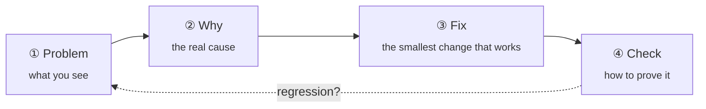

<p align="center">
  <a href="https://salimkaboura8.github.io/dev-notes/">
    
  </a>
</p>

<p align="center">
  <a href="https://salimkaboura8.github.io/dev-notes/"></a>
  <a href="https://github.com/salimkaboura8/dev-notes/actions/workflows/check.yml"></a>
  
  <a href="LICENSE"></a>
</p>

<p align="center">
  <b>Things that cost me time once — written down so they won't twice.</b><br>
  Every note follows the same four steps: <b>Problem → Why → Fix → Check</b>.
</p>

---

## 📚 Notes

<!-- notes:start -->
| Note | In one line | Tags |
|---|---|---|
| ["reading 'onAriaChanged'" — don't bind aria-* on ion-button](notes/ionic-aria-stencil-crash.md) | A bound aria attribute that changes before the Stencil component lazy-loads crashes it. | `ionic` `stencil` `accessibility` `sentry` |
| [Arabic RTL — flip the text, not every layout](notes/rtl-text-not-layout.md) | Logical CSS properties everywhere, then pin the few areas that must stay left-to-right. | `i18n` `rtl` `css` `ionic` |
| [Capacitor 8 release AAB needs a JDK 21 toolchain](notes/android-aab-jdk.md) | bundleRelease fails with JDK 17 or 25 — Android Studio already ships the JDK 21 you need. | `android` `capacitor` `gradle` |
| [Default to the device language, keep the user's choice](notes/i18n-device-language.md) | First launch follows the phone or browser; an explicit pick sticks forever, even if iOS wipes WebView storage. | `i18n` `capacitor` `angular` |
| [GitHub SSH on Windows — key accepted, push still denied](notes/github-ssh-windows.md) | "Permission denied (publickey)" while GitHub says it accepts your key means nobody can unlock the passphrase. | `git` `windows` `ssh` |
| [Let Postgres RLS be your authorization layer](notes/supabase-rls-forward-jwt.md) | An API in front of Supabase forwards the caller's JWT, so row-level security decides — not hand-written checks. | `supabase` `postgres` `fastapi` `security` |
| [OnPush everywhere, and the one line you must not forget](notes/angular-onpush-markforcheck.md) | With ChangeDetectionStrategy.OnPush, async state changes don't render until you call markForCheck(). | `angular` `ionic` `performance` |
| [Push to main = production, safely](notes/vercel-deploy-gated-by-ci.md) | Vercel Deployment Checks hold the release until CI is green, and a /health version proves what is live. | `vercel` `github-actions` `ci` `deploy` |
<!-- notes:end -->

## 🧭 How a note works



## 🛠 Stack these notes come from

<p>
  
  
  
  
  
  
  
</p>

## ✍️ Add a note

```bash
cp notes/_template.md.txt notes/my-new-note.md   # kebab-case file name
npm ci
npm run check    # validates front matter + the 4 sections, and the README index
npm run build    # rewrites the table above and builds the site into _site/
npm run serve    # http://localhost:4321/dev-notes/
```

On every push to `main`, CI validates the notes and GitHub Pages publishes the site. A note with a missing section, a bad date or a stale README index fails the build.

## 📄 License

[MIT](LICENSE) — copy anything that helps.
